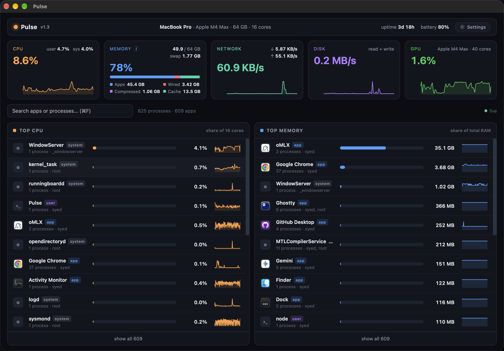
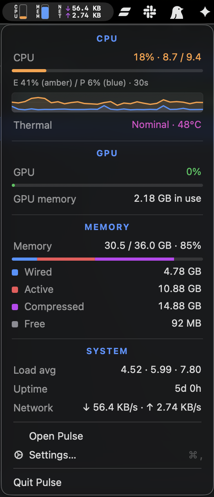

# Pulse: real-time Mac resource dashboard

See, in real time, exactly which apps are eating your CPU and memory, and manage them.

**[Download .dmg](https://github.com/ssa17/pulse/releases/latest/download/Pulse.dmg)** · [All releases](https://github.com/ssa17/pulse/releases)



## Install

1. Download the latest **Pulse.dmg** (the link above, or the [releases page](https://github.com/ssa17/pulse/releases))
2. Open it and drag **Pulse** into your **Applications** folder
3. Launch Pulse from Applications

Pulse checks for updates automatically and installs them. You never need to re-download.

> **Private by design.** Pulse runs entirely on your machine: it samples local system
> data and serves the dashboard over `127.0.0.1`. Nothing is sent anywhere, and it
> works fully offline.

## What you get

- **Top CPU / Top Memory panels:** every process grouped into its app (Chrome's 30
  helper processes become one "Google Chrome" row), with real app icons, a bar showing
  the share of your *total* resources, live values, and sparklines.
- **Memory explainer:** an info button on the Memory card explains what the
  kernel-managed buckets are (wired / compressed / file cache), why they grow,
  with live sparklines, and how each one goes away (quit the hogs, reboot for
  the kernel's share, `sudo purge` for the file cache).
- **System cards:** CPU (user/sys/idle), memory breakdown (apps / wired / compressed /
  cache / free + swap), network, disk, Apple Silicon GPU utilization, battery, thermal state, uptime.
- **Detail drawer:** click any app to see every process behind it: its role (web page /
  GPU / helper…), full command line, CPU, memory, state, start time, plus **kill** and
  **Quit app** buttons.
- **Search:** filter by app name, bundle path, or any process/command.
- **Menu-bar item & dropdown:** live status-bar capsules (CPU, GPU, Memory, Network ↓/↑)
  and a dropdown menu with colored utilization bars, thermal state, and uptime, all
  individually toggleable and reorderable in Settings.

<p align="center">
  
</p>

## Requirements

- macOS 13 (Ventura) or later, Apple Silicon
- [Node.js](https://nodejs.org): the dashboard backend runs on your system Node
  (`brew install node` if you don't have it). No other dependencies.

---

## License

**Pulse is free to use and free to modify, but not for sale.**

You may use, study, and modify this software for personal or non-commercial purposes. You may distribute modified versions, provided you also distribute them for free and do not charge money for them or bundle them into a paid product.

See [LICENSE](LICENSE) for the full text.

---

## For developers

**Tech stack:** Swift (native app shell: WKWebView, menu-bar item, Sparkle)
· Node.js (zero-dependency backend: sampling, SSE) · vanilla JS (single-file
UI, no build step). No npm packages anywhere.

### Build from source

```bash
./app/build.sh              # builds dist/Pulse.app (needs Xcode CLT: swiftc, + Node)
./app/build.sh --notarize   # + notarize & staple (enables Touch ID on "Purge disk cache")
open dist/Pulse.app
```

The "Purge disk cache" button (Memory ⓘ) shows a Touch ID / password prompt;
macOS 26.3+ only offers the fingerprint on **notarized** builds. `build.sh`
re-notarizes automatically once the previous build was (pass
`--no-notarize` to opt out); in web mode the prompt is password-only.

`Pulse.app` is a small native Swift shell (WKWebView) that:
- is **single-instance**: launching it again focuses the existing window rather than
  spawning a duplicate
- **reuses a running backend** via `~/.pulse/port` (works across app ↔ web mode),
  otherwise spawns one on a **dynamic free port** (no fixed port, no conflicts)
- kills its backend on quit (plus a watchdog in the backend for abnormal exits)
- shows a **live menu-bar status item** (CPU + memory graphs) with a menu
- renders native dialogs for the in-app confirm() prompts (kill / quit-app buttons)
- checks for updates via [Sparkle](https://sparkle-project.org)

In-app: **Cmd-R** reloads, **Cmd-Q** quits. `PULSE_SELFTEST=1` runs a render +
interaction self-test (with `PULSE_AUTOCONFIRM=1` to auto-approve dialogs) and exits.

**Footprint:** the `.app` is ~3.6 MB on disk (mostly the bundled Sparkle update
framework; the app itself is tiny and uses your system Node, not a bundled runtime).
At runtime it uses ~300–400 MB, mostly WebKit's own processes (the webview UI);
the Node backend is heap-capped to stay lean. Shared state (port file, icon cache)
lives in `~/.pulse/`, never inside the bundle.

### Web mode

```bash
node server.js          # → http://127.0.0.1:8787
```

### How it reads your Mac

| Source | Data |
|---|---|
| `ps` (all processes) | per-process CPU (delta of cumulative CPU time → real-time), RSS memory, state, start time, full command |
| `vm_stat` + `sysctl` | memory breakdown, swap, load average, uptime, total RAM |
| `top -l 2` | system CPU user/sys/idle |
| `netstat -ib` | network in/out rates |
| `iostat` | disk read/write rate |
| `pmset` | battery |
| `system_profiler` | machine identity (model, chip, memory) |

**App intelligence:** a process is attributed to an app if its executable lives inside
a `.app` bundle (outermost bundle wins, so nested helper bundles resolve to the real
app), or if any ancestor (up to 8 levels) does, so a `node` process spawned by
VS Code shows up under VS Code. Everything else is grouped by executable name and
tagged `system` or `user`. Common daemons (WindowServer, mdworker, kernel_task, …)
carry a one-line explanation in the detail view.

### Notes

- CPU % is expressed as a share of **all** cores (16 cores fully busy = 100%).
- Memory per app is the sum of process RSS (shared pages can be counted more than once).
- App icons are extracted from the `.app` bundle with `sips` and cached in
  `~/.pulse/icons/`.
- Kill buttons send SIGTERM (SIGKILL available via the API: `POST /api/kill {"pid":123,"sig":"KILL"}`).
- Binds to 127.0.0.1 only.
- Sampling runs every second. `netstat -ib` can take seconds on machines with many
  interfaces, so it runs in the background and the network card updates every ~5s
  (rates are computed over the real elapsed time, so they stay accurate).
- The first sample skips the 1-second-window commands (top, iostat) so the UI gets
  real data almost instantly; they fill in on the next tick.

### Environment variables

| Var | Default | Meaning |
|---|---|---|
| `PORT` | `8787` (web) / dynamic (app) | HTTP port; `0` = OS picks a free one |
| `HOST` | `127.0.0.1` | bind address |
| `INTERVAL` | `1000` | sampling interval (ms) |
| `PULSE` | — | set by the app; makes the backend use a dynamic port + orphan watchdog |
| `PULSE_NODE` | — | explicit path to the node binary (app mode) |
| `PULSE_PORT` | — | force a specific port (app mode) |
| `PULSE_SELFTEST=1` | — | app prints a render + interaction self-test and exits |

### Project layout

```
server.js            zero-dependency Node backend (sampling, grouping, SSE)
public/index.html    the dashboard UI (single file, no build step)
app/Pulse.swift      native app shell (WKWebView + backend lifecycle + Sparkle)
app/Info.plist       app metadata (local networking, icon, Sparkle keys)
app/make-icon.mjs    generates the app icon (pure Node PNG writer)
app/build.sh         builds dist/Pulse.app (bundles the Sparkle framework)
vendor/fetch-sparkle.sh  downloads the pre-built Sparkle framework (gitignored)
fastlane/Fastfile    distrib + release lanes (sign, notarize, DMG, appcast, GitHub)
releases/appcast.xml Sparkle update feed (served via raw GitHub)
docs/                contracts, gotchas, and the distribution guide
```

### Distribution

Signing, notarization, and the release workflow (DMG + Sparkle auto-updates +
GitHub Releases) are documented in [docs/distribution-guide.md](docs/distribution-guide.md).
